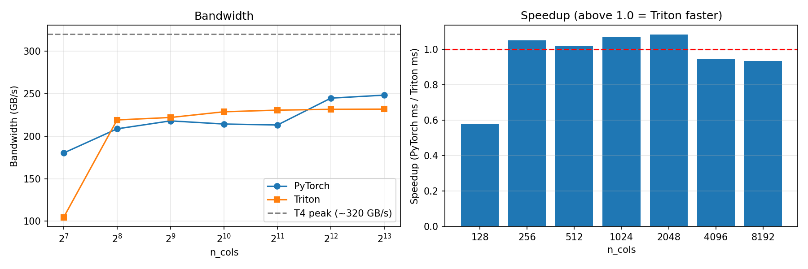
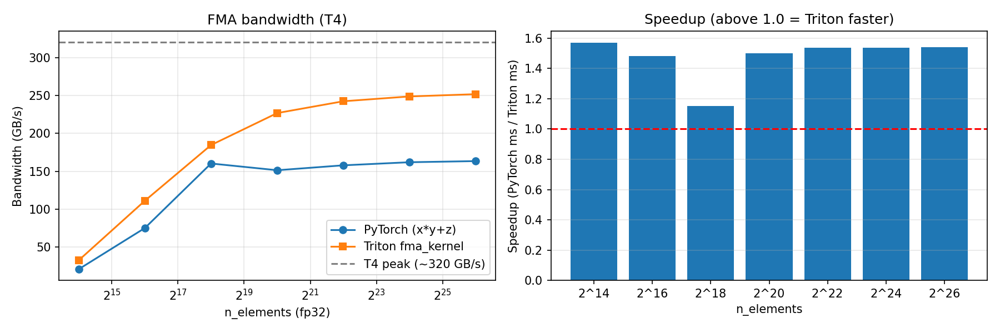
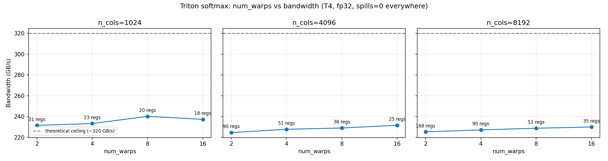

# PTX-Level Analysis of Custom Triton Kernels

Custom Triton kernels (fused multiply-add and row softmax) benchmarked against PyTorch on a Colab T4, with the generated PTX read and mapped back to the Triton source. The goal is to see what the NVPTX backend decides, and to test performance hypotheses with evidence.

## Key results

| Question | Result |
|---|---|
| Triton softmax vs PyTorch | Parity at 256 to 2048 columns (up to 1.08x), about 0.95x at 4096 and above, 0.57x at 128 |
| Practical bandwidth ceiling (T4, fp32) | About 240 GB/s, measured with `x.clone()` (spec peak is about 320 GB/s) |
| Is large row slowdown from register pressure? | No. Registers 168 to 35, occupancy 37.5 to 100 percent (theoretical), zero spills, bandwidth moved about 2 percent |
| What did the compiler do? | 4 wide vector loads and stores, predication instead of branches, `fma.rn.f32`, `shl` strength reduction, `ex2.approx` for exp, shuffle plus shared memory reductions |
| Remaining gap at large rows | Unexplained. PyTorch uses a 1024 thread block per row, my sweep stopped at 512 threads |

Plots:





## Documentation

- [`results/findings.md`](results/findings.md): results, tested hypotheses, limitations
- [`ptx_analysis/analysis.md`](ptx_analysis/analysis.md): PTX mapped line by line to Triton source

## Repo layout

```
kernels/        Triton kernels (fma_kernel.py, softmax_kernel.py)
benchmarks/     Benchmark, tuning, occupancy, and profiler scripts
ptx_analysis/   Dumped .ptx files and analysis.md
results/        CSVs, plots and findings.md
```

## Run it

Needs an NVIDIA GPU. On free Colab, select a T4 runtime:

```bash
git clone https://github.com/Mubaris2/triton-ptx-analysis.git
cd triton-ptx-analysis
pip install -r requirements.txt
python benchmarks/benchmark_softmax.py
python benchmarks/benchmark_fma.py
python benchmarks/warp_tuning.py
python benchmarks/occupancy.py
python benchmarks/profile_torch_softmax.py
```

## Method notes

- Timing: `triton.testing.do_bench`. Run to run noise is about 1 to 1.5 percent, so smaller differences are not claimed.
- Bandwidth: softmax counts one read and one write. FMA counts three reads and one write.
- Occupancy is a theoretical calculation from register counts, not an Nsight measurement.
- PyTorch kernels were examined through `torch.profiler` launch config only.

## Limitations

Single GPU (T4), fp32 only, no Nsight Compute, no loop based kernel (so no LICM observed). See `docs/findings.md`.

## References

- Triton tutorials: https://triton-lang.org/main/getting-started/tutorials
- PTX ISA: https://docs.nvidia.com/cuda/parallel-thread-execution/
